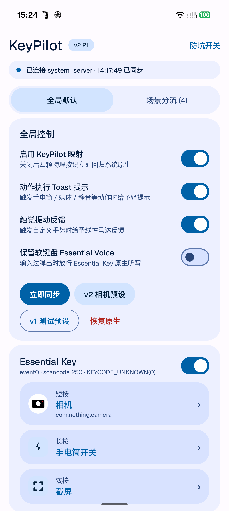
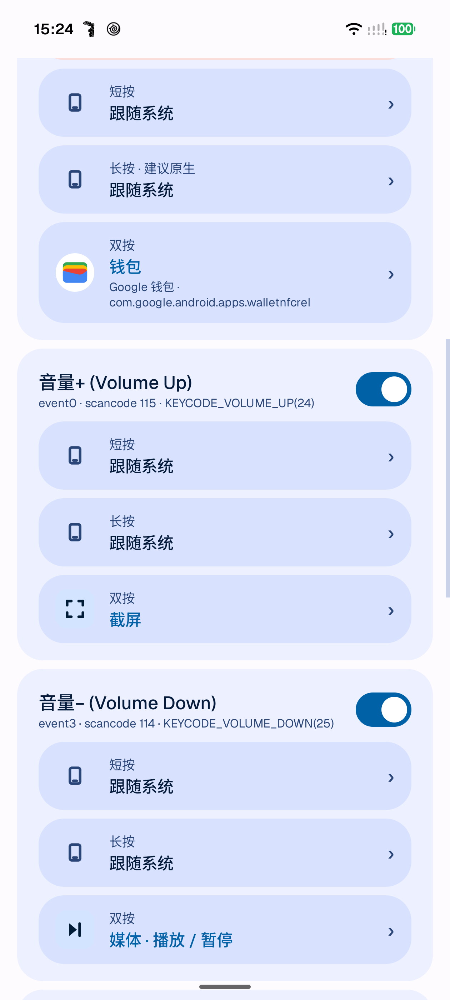
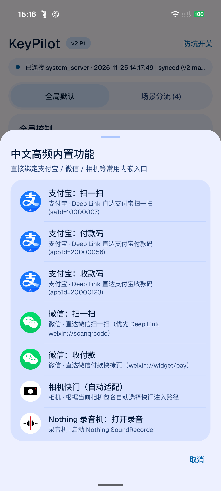
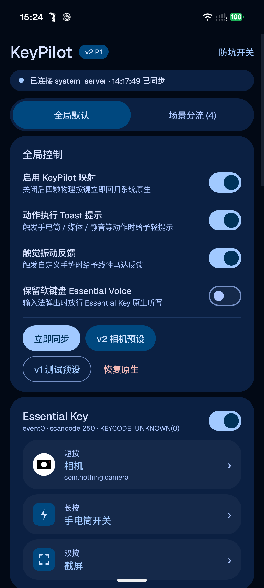

# 按键自定义（KeyPilot 框架）—— 从四按键全息勘察到上下文感知与 Material 3 落地

> 设备：Nothing Phone (3)（A024，代号 Metroid）| 系统：Nothing OS 5.0（Android 17，SDK 37）
> Build：`C5.0-260924-2115` | 内核：`6.6.127-android15-8` | Magisk v31.1 + JingMatrix/Vector v2.2（LSPosed）
> 记录日期：2026-11-24 – 2026-11-25
> 状态：✅ **已定稿** —— 四按键静态/动态全息勘察 + 离线 DEX 反汇编 + **KeyPilot v1（13/13 过）** + **v2 P1 上下文分流（11/11 过）** + **Material 3 全界面 5 轮真机视觉自审（10/10 全绿）**全部闭环
> 产物 APK：[`release/KeyPilot.apk`](release/KeyPilot.apk)（SHA256：`8737b7838eee94f7cc10f32539ecb95f74517e1699d7c032cb866bb173d40d8b`）
> 本机全量存证：`NothingPhone3-按键探查/`（127 份勘察+PoC 存证）· `KeyPilot/verify*/`（三期全量截图与 logcat）

---

## 一、起源：一颗 `input keyevent` 完全打不动的 Essential Key

Nothing Phone (3) 机身左侧多出了一颗专属物理按键 **Essential Key**。但原厂默认只绑定 Nothing 自家 Essential Space（短按截屏输入、长按按住录音、双按打开 Space），既不支持自定义动作，在排查自动化脚本时更撞上了一连串底层反直觉现象：

1. **全系统 184 个 `.kl` 键位文件零映射**：`P1-输入静态勘察` 实证 Essential Key 挂在 `/dev/input/event0`（`gpio-keys` 设备树节点 `ai_button`，`linux,code=250 (0x00fa)`，防抖 15ms，具 `wakeup` 唤醒能力），但系统里没有任何 `.kl` 为 `250` 分配 Android KeyCode，EventHub 只能吐出 **`KEYCODE_UNKNOWN (0)` + `scanCode=250`**——这导致常规 `input keyevent` 完全无效，自动化注入**只能走 root `sendevent`**，普通无障碍按键映射 App 也无法稳定消费它。
2. **硬编码 `scanCode == 250` 截胡**：对 `services.jar`、`nt-services.jar`、`EssentialRecorder.apk`、`EssentialSpace.apk` 做离线 `dexdump -d` 字节码精查（P4）后彻底破案——`PhoneWindowManager.handleKeyGesture` 早在 `getKeyCode()` 之前就硬编码判断 `event.getScanCode() == 250`，直接转发至未混淆公有接口 **`com.nothing.server.ext.INtEssentialKey.onRecord(KeyEvent)`**（实现类 `com.android.server.wm.NtEssentialKeyImpl`，位于 `nt-services.jar`），紧接着由 `EssentialRecorder` 的 11 态状态机完成短按 / 长按（`500ms`）/ 双按（`300ms`）分流。
3. **两条“想当然路线”在真机 PoC 中被证伪**：
   - **路线 A（Magisk 挂载 `.kl` 赋予 KeyCode）❌**：`handleKeyGesture` 按 `scanCode==250` 抢跑，改 `.kl` 反而与原生双触发；且 `/` 为只读 `erofs` 无热重载命令。
   - **路线 C（`settings put global side_button 0` 静音原生）❌**：反汇编证实 `NtEssentialKeyImpl` **0 处引用 `side_button`**；真机 PoC-1a 设为 `0` 后照常弹出 `FocusActivity` 并持锁 `95ms`。此前困惑的 `nt_essential_voice_action_hold=0` 也经字节码查明仅管软键盘弹出时的 `Essential Voice` 听写分支。
4. **最终选型（路线 B 主力 + 路线 F 备胎）**：
   - **主力路线 B（KeyPilot Xposed 模块）**：在 `system_server` 内直钩未混淆接口 `NtEssentialKeyImpl.onRecord(KeyEvent)`（接管 Essential Key）与 `PhoneWindowManager.interceptKeyBeforeQueueing`（接管电源 / 音量±，并早于下游 `NothingTweaks`），零系统分区改动、零原生麦克风/截屏副作用、支持热更新与单手势混搭放行。
   - **备选路线 F（可选 Magisk Native 守护 `keypilotd`）**：利用本机已就绪的 `/dev/uinput` 做 `EVIOCGRAB` 独占代理 `event0`（透传 `115` 音量+、截留 `250`），作为将来免 Xposed 的抗 OTA 兜底方案一并沉淀在 [`KeyPilot/magisk/`](KeyPilot/magisk/)。

---

## 二、四按键底层能力全景表（P1/P2/P4 实证）

> 注：重启后内核异步探测可能导致 `pmic_pwrkey` / `pmic_resin` 的 `event*` 编号动态漂移（如 `event2/3` ↔ `event1/2`）；KeyPilot Java 钩子按 `scanCode`/`keyCode` 判定，天然免疫节点漂移。

| 物理按键 | 内核驱动 / 典型节点 | Linux Scancode | KeyLayout → Android KeyCode | 原生短按 / 长按 / 双按行为（P2 17 项实测） | 硬件组合键规则 | KeyPilot 接管方式与安全边界 |
|---|---|---|---|---|---|---|
| **Essential Key** | `gpio-keys` (`ai_button`, 15ms 防抖, wakeup)<br>`/dev/input/event0` | **`250`** (`0x00fa`) | **无 `.kl` 映射** →<br>`KEYCODE_UNKNOWN (0)` | 短按：`FocusActivity` 截屏+输入<br>长按（≥500ms）：按住 16kHz 录音+松手保存<br>双按（<300ms）：`EssentialSpace` | 无原生组合键 | 钩 `NtEssentialKeyImpl.onRecord`；支持三手势任意自定义、混搭放行原生、软键盘 Essential Voice 放行、OS 5.1 共存让位 |
| **电源键 (Power)** | `pmic_pwrkey` (PMK8550)<br>`/dev/input/event2` | `116` (`0x0074`) | `Generic.kl` →<br>`KEYCODE_POWER (26)` | 短按：+300ms 息屏 AOD Doze<br>长按（500ms）：6 项电源菜单<br>双按（<300ms）：相机手势（本机曾被 `NothingTweaks` 劫持至 Google Wallet） | `+ 音量−` → 截屏<br>`+ 音量+` → 电源菜单 | 钩 `PhoneWindowManager.interceptKeyBeforeQueueing`；**安全红线①**：长按默认锁死原生电源菜单（需二次弹窗显式授权）；双按上游盖过 `NothingTweaks` |
| **音量+ (Vol Up)** | `gpio-keys` (`vol_up`, 15ms 防抖, wakeup)<br>`/dev/input/event0` | `115` (`0x0073`) | `gpio-keys.kl` →<br>`KEYCODE_VOLUME_UP (24)` | 短按：首按仅弹 `VolumeDialog` (`dir=0`)<br>长按：~450ms 后连续递增媒体音量 | `+ 电源` → 电源菜单<br>`+ 音量−` → 无障碍 3s（未绑服务） | 同上；仅在有自定义绑定时拦截，未绑定短按经 Bypass 令牌忠实回放原生 `VolumeDialog`；**安全红线②**：组合键护盾永久放行 |
| **音量− (Vol Down)** | `pmic_resin` (PMK8550)<br>`/dev/input/event3` | `114` (`0x0072`) | `Generic.kl` →<br>`KEYCODE_VOLUME_DOWN (25)` | 短按：首按仅弹 `VolumeDialog` (`dir=0`)<br>长按：~450ms 后连续递减媒体音量 | `+ 电源` → 截屏<br>`+ 音量+` → 同上 | 同上；直接拦截物理 `KeyEvent` 切歌，彻底根治 Tasker 等工具“媒体音量到顶时切歌失效”的顽疾 |

---

## 三、KeyPilot 系统架构（v1 基建 + v2 P1 上下文分流）

```text
[Linux evdev: event0 (EK=250, Vol+=115) / pmic_pwrkey (116) / pmic_resin (114)]
                                      │
                                      ▼
┌──────────────────────────────────────────────────────────────────────────────┐
│                 system_server 进程 (uid=1000, LSPosed 作用域 system)           │
│                                                                              │
│  1. ForegroundTracker (三通道无锁上下文缓存，O(1) 零阻塞)                       │
│     • DisplayContent#setFocusedApp + TaskChangeNotificationController        │
│       + ITaskStackListener + KeyguardManager + PowerManager + isExternal()   │
│                                                                              │
│  2. StandardKeysHook (PhoneWindowManager#interceptKeyBeforeQueueing 全重载)   │
│     ├─ Bypass Token 命中 (自回放事件) ──────────────────────► 原生放行         │
│     ├─ CHORD SHIELD (POWER+VOL± / VOL++VOL−) ──► 撤 FSM + 放行组合键          │
│     ├─ 黑名单 0ms 旁路 / 息锁屏总控 ────────────────────────► 原生放行         │
│     └─ GestureStateMachine (500ms 长按 / 300ms 双按 / Partial WL)             │
│                                                                              │
│  3. EssentialKeyHook (NtEssentialKeyImpl#onRecord + 三层兜底探针)              │
│     ├─ 总开关关 / 黑名单 / IME Voice / OS 5.1 让位 ─────────► invokeOriginal   │
│     └─ GestureStateMachine (零原生 FULL_WAKE_LOCK / 零录音绿点)                │
│                                                                              │
│  4. ProfileResolver (O(N) < 0.05ms 分流决策)                                  │
│     黑名单旁路 → 安全红线 → profiles[] 按 priority 降序匹配 → 回退全局 keys     │
│                                                                              │
│  5. ActionExecutor (独立后台线程，绝不阻塞 InputDispatcher)                     │
│     v1 20 项系统/应用动作 + v2 11 项上下文/直达动作（总计 31 项 ActionType）     │
│                                                                              │
│  6. ConfigBridge (热更新 Broadcast + 原子写盘 /data/system/keypilot.json)      │
└───────────────────────────────▲──────────────────────────┬───────────────────┘
          CONFIG_UPDATE 广播    │                          │ StatusProvider.call
          (v1/v2 JSON 热同步)   │                          │ (心跳 + 运行日志)
┌───────────────────────────────┴──────────────────────────▼───────────────────┐
│        KeyPilot 配置 APP (io.github.rtzhang.keypilot, 纯 SDK Material 3)       │
│  • 全局默认 (4×3) / 场景分流 Profiles 双 Tab · 8 套社区场景模板 · 6 项防坑开关   │
└──────────────────────────────────────────────────────────────────────────────┘
```

### 3.1 配置协议（JSON v2，100% 向后兼容 v1）
- **热更新 + 冷启动双路径**：APP 修改后立即存私有 `files/keypilot_config.json` 并发送 `io.github.rtzhang.keypilot.CONFIG_UPDATE` 广播；`system_server` 内 `ConfigBridge` 毫秒级切换内存 `volatile` 配置，后台线程采用 `.tmp → fsync → rename` 原子持久化至 `/data/system/keypilot.json`（`system:system 0600`），重启后不打开 APP 即刻生效。
- **分层继承模型**：
  $$\text{EffectiveAction}(key, gesture, ctx) = \text{FirstMatch}(profiles, key, gesture, ctx) \;\Vert\; \text{GlobalKeys}(key, gesture)$$
  每个 `ActionProfile` 包含 `packages`（精确/通配）、`excludePackages`、`activityRegex`、`keyguard`、`screen`、`priority` 与稀疏 `bindings` 覆写表；未声明的手势自动继承全局矩阵。详细字段与示例见 [`docs/DESIGN.md`](docs/DESIGN.md) 与 [`docs/V2-PLAN.md`](docs/V2-PLAN.md)。

### 3.2 动作目录（v1 20 项 + v2 P1 扩展至 31 项）
- **v1 基础闭环（20 项）**：跟随系统原生、无动作（屏蔽）、启动应用、启动指定 Activity、发送自定义广播、打开相机、手电筒开关、全屏截屏、息屏锁屏、电源菜单、静音/铃声循环、媒体播放/暂停/上/下一曲、返回/主页/最近任务、打开设置、打开 Essential Space。
- **v2 P1 上下文与直达增强**：
  - `camera_shutter`（相机快门）：内置三档策略架构，P1 落地 Tier 1 系统键注入——真机实证 `com.nothing.camera` 首选 `KEYCODE_CAMERA (27)` 零冲突成片，`GoogleCamera*` 自动走 Bypass `VOLUME_DOWN (25)` 脉冲。
  - `in_app_preset`（中文高频内置功能包）：开箱即用直达 **支付宝扫一扫 / 付款码 / 收款码**、**微信扫一扫 / 收付款**、相机快门、Nothing 录音机。
  - `deep_link`（URI Scheme 直达）、`media_transport`（`MediaSessionManager` 精准媒体控制 + `simulateMediaButton` 兼容 Spotify）、`key_inject`（自定义 KeyCode 注入，如阅读器 `PAGE_UP`/`PAGE_DOWN`）、`partial_screenshot`（区域截图）、`ringer_cycle`（侧键轻 Toast 增强）、`expand_notifications` / `expand_qs`、`context_var_broadcast`（向 Tasker/MacroDroid 导出 `${fg_pkg}` / `${fg_activity}`）。
- **场景模板库（B1–B8）**：内置相机内短按快门（B4）、音乐 App 内切歌（B5）、游戏防误触还原原生（B6）、阅读器翻页（B1）、通话/录音 PTT 静音（B3）、前台变量广播（B8），以及标为实验级的 P2 导航缩放（B2）与微信按住说话（B7）。

### 3.3 6 项防坑开关（升格为 P1 必做基建）
1. **全局 App 黑名单（`blacklistPackages`）**：命中银行/支付/游戏等包名在最前端 0ms 纯原生旁路。
2. **息屏 / 锁屏独立总控**：全局 `allowWhenScreenOff` / `allowWhenKeyguardLocked` + 单个 Profile 细粒度覆写。
3. **保留默认动作不吞键（`passthroughDefault`）**：执行自定义动作同时经 Bypass 通道放行原生键（零递归）。
4. **无障碍冲突检测（`ConflictDetector`）**：自动扫描 Google Select to Speak（已证实破坏音量键拍照快门）及第三方抢键无障碍服务，展示 `errorContainer` 警示卡并一键跳转设置。
5. **快门三档回退 + 蓝牙自拍杆豁免**：按 `InputDevice.isExternal()` 放行外设蓝牙快门，防止误拦自拍杆。
6. **Nothing OS 5.1 官方重映射共存策略（`officialRemapPolicy`）**：预置 `takeover`（独占）/ `yield_single_click`（桌面单击让位官方，相机内单击仍走快门，双/长按继续由 KeyPilot 扩展）/ `yield_all` 三档热切换。

---

## 四、三期真机验证结果总览

全部测试均在 Nothing Phone (3)（`C5.0-260924-2115`）真机闭环完成，全程 `system_server` 零崩溃、Clash/`tun0` 正常、10 个 Magisk 模块 0 disable：

| 阶段 | 验证范围 | 通过率 | 迭代修复的关键问题（真实踩坑） | 详报 |
|---|---|---|---|---|
| **v1 基建实测**（2026-11-24） | `TC-01 ~ TC-07`（EK 三手势、音量±双按、电源双按盖过 NothingTweaks、热更新+冷启动）<br>`REG-01 ~ REG-06`（音量/电源原生、电源长按菜单、双组合键护盾、总开关关闭恢复） | **13 / 13 PASS**<br>（7 TC + 6 REG） | ① **手电筒二次长按仍 ON**：`TorchCallback` 初始化竞态覆写 `sTorchEnabled`，改为先定目标 `cameraId` + 500ms 去抖后 `ON → OFF` 稳定通过；<br>② **Vector 作用域命名坑**：`system_server` 在 Vector 数据库中须加 `system/0`；<br>③ **节点漂移**：重启后 `event2/3` 漂移至 `event1/2`，KeyPilot 按 `scanCode`/`keyCode` 识别天然免疫 | [`docs/TESTPLAN_V1_RESULTS.md`](docs/TESTPLAN_V1_RESULTS.md) |
| **v2 P1 实测**（2026-11-25） | `V2-TC-01 ~ 06`（非相机开相机→相机内同手势快门、支付宝扫一扫直达、QQ 音乐音量满格切歌、OS 5.1 `yield_single_click` 热切换、分层继承+闪光灯占用兜底）<br>`V2-REG-01 ~ 05`（黑名单 0ms 旁路、`passthroughDefault` 不吞键、关闭 Profiles 回退 v1、安全红线①②） | **11 / 11 PASS**<br>（6 TC + 5 REG） | ① **相机占用闪光灯异常解包**：`Method.invoke` 将 `CameraAccessException(MAX_CAMERAS_IN_USE)` 包进 `InvocationTargetException`，解包 `getCause()` 后零 `[ERR]` 并弹友好提示「相机占用中，无法切换手电筒」；<br>② **Nothing Camera 快门定案**：实证 `KEYCODE_CAMERA (27)` 首次即成片（`38→39`）且不与音量缩放冲突，已升级为 `com.nothing.camera` 首选策略 | [`docs/TESTPLAN_V2_RESULTS.md`](docs/TESTPLAN_V2_RESULTS.md) |
| **Material 3 UI 美化自审**（2026-11-25） | 浅色/深色双模式、双 Tab、4×3 矩阵、动作/预设/应用选择器、场景编辑器、防坑开关弹窗 | **10 / 10 GREEN**<br>（5 轮自审闭环） | ① `MaxHeightScrollView` 解决弹窗底栏裁切；<br>② 零 padding 自绘 `ThumbCircleDrawable` 根治 Android `Switch` 误把 `InsetDrawable` 当光学缩进导致滑块外凸；<br>③ `ScrollView.setClipToPadding(true)` 消除滚动与状态栏碰撞；<br>④ 底部弹窗改全屏透明遮罩达成 Edge-to-Edge 零灰缝贴底；<br>⑤ 独立复审补修（Round 5）：精简状态条文案与解除 Profile 标题/副标题单行截断 | [`docs/UI_AUDIT.md`](docs/UI_AUDIT.md) |

---

## 五、Material 3 界面与真机效果展示

KeyPilot 坚持**零 Gradle / 零 Material 依赖**，全程用纯 Android SDK + `aapt2 + 两阶段 javac + d8` 裸编译（确保 Xposed 桩类 0 字节进入 `classes.dex`），手写完整 M3 设计系统（[`UiTheme.java`](KeyPilot/app/src/main/java/io/github/rtzhang/keypilot/ui/UiTheme.java)）：
- **动态取色**：直读 Android 12+ `system_accent1_*` / `system_neutral1_*` / `system_neutral2_*`，昼夜模式自动跟随壁纸色板。
- **统一圆角族**：卡片 `24dp` / 输入与下拉 `26dp` / 药丸按钮、Switch、Tab、Edge-to-Edge 底部弹窗顶角 `28dp`。
- **真实图标与清晰分隔**：[`AppIconCache.java`](KeyPilot/app/src/main/java/io/github/rtzhang/keypilot/ui/AppIconCache.java) + [`ActionIcons.java`](KeyPilot/app/src/main/java/io/github/rtzhang/keypilot/ui/ActionIcons.java) 在应用列表、高频内置预设、已绑定手势行及场景分流卡片上统一呈现圆角真实 APP 图标、所属应用名称与 `56dp` 缩进分隔线。

| 浅色 · 全局默认 Tab | 浅色 · 4×3 按键矩阵 | 浅色 · v2 场景分流 Profiles | 底部弹窗 · 中文高频内置功能 |
|---|---|---|---|
|  |  |  |  |

| 底部弹窗 · 应用选择器（带图标分隔） | v2 实测 · 相机上下文分流 | 深色动态 Monet · 全局默认 | 深色动态 Monet · 场景分流 |
|---|---|---|---|
|  |  |  |  |

---

## 六、安装、激活与使用指南

### 6.1 直接安装（推荐）
1. 下载 [`release/KeyPilot.apk`](release/KeyPilot.apk) 并核对 [`release/KeyPilot.apk.sha256`](release/KeyPilot.apk.sha256)：
   ```bash
   sha256sum release/KeyPilot.apk
   # 预期：8737b7838eee94f7cc10f32539ecb95f74517e1699d7c032cb866bb173d40d8b
   adb install -r release/KeyPilot.apk
   ```
2. 在 **LSPosed / Vector 管理器** 中启用 **KeyPilot**，勾选作用域：
   - **系统框架**（`system` / `android`，核心必选）
   - `com.nothing.ntessentialrecorder`（可选，仅用于零唤醒遥测日志）
3. **重启手机**一次使 `system_server` 挂载钩子。
4. 打开 KeyPilot，确认顶部状态条显示 **`已连接 system_server · HH:mm:ss 已同步`**，即可自由配置（所有修改均为毫秒级热更新，无需再重启）：
   - 点 **「v2 相机预设」** 一键体验「非相机短按 EK 打开相机 → 进入相机同手势变快门、双按支付宝扫一扫、长按手电筒、音乐 App 切歌、游戏防误触」。
   - 点右上角 **「防坑开关」** 配置银行/支付黑名单、息锁屏开关与 Nothing OS 5.1 共存模式。

### 6.2 从源码自行构建
源码位于 [`KeyPilot/`](KeyPilot/)（已排除 keystore 与编译中间产物，首次运行会自动生成本地签名证书）：
```bash
cd KeyPilot
# 需要 Android SDK Build-Tools 37.0.0 + android-37 + JDK 17 + Python 3 (Pillow)
bash build.sh
```
构建管线执行两阶段 `javac`（`app/src/stubs` 与模块源码隔离编译），并在末尾自动运行 `apksigner verify`、`aapt2 badging` 与 `dexdump` 审计，强制校验 `de/robv/android/xposed` 桩类在 `classes.dex` 中为 **0 matches**。

---

## 七、后续演进路线图（P2 / P3）

详细技术论证见 [`docs/V2-CONTEXT-RESEARCH.md`](docs/V2-CONTEXT-RESEARCH.md)、[`docs/RESEARCH-community.md`](docs/RESEARCH-community.md) 与 [`docs/V2-PLAN.md`](docs/V2-PLAN.md)：

- **Phase 2（P2）—— 全机快捷方式引擎 + 可选无障碍插件**
  1. **`ShortcutBridge`**：在 `system_server` 反射调用 `ShortcutServiceInternal`，无需默认桌面权限即可枚举并直启任意 App 长按菜单快捷方式（彻底覆盖无公开 Deep Link 的应用内入口）。
  2. **`AccessBridge`（可选无障碍服务，默认关闭不污染 P1）**：支持 `a11y_click`（按 ViewId/文本点击控件，快门 Tier 2）、`a11y_gesture`（归一化坐标点按/滑动/长按/双指缩放，快门 Tier 3 + 实验级模板 **B2 导航缩放** / **B7 微信按住说话**）与悬浮准星节点拾取器。
- **Phase 3（P3）—— 进阶宿主直调与规则分享生态**
  - 对极少数无 Shortcut/Deep Link/快捷键的开源或系统 App 提供可选 `InAppHookBridge`（严格将银行/支付/强风控超级 App 列为禁止持钩黑名单），并支持 JSON Profile 场景包导入导出。

---

## 八、证据与文档索引

### 8.1 仓库内文档与资产（本章目录）
| 路径 | 说明 |
|---|---|
| [`KeyPilot/`](KeyPilot/) | 完整源码快照（`app/`、`magisk/`、`scripts/`、`build.sh`，不含 keystore 与 `out/`） |
| [`release/KeyPilot.apk`](release/KeyPilot.apk) + [`.sha256`](release/KeyPilot.apk.sha256) | 最终签名安装产物（v2+v3，SHA256 `8737b7838e...`） |
| [`docs/DESIGN.md`](docs/DESIGN.md) | KeyPilot v1 总体架构、钩点选型与 JSON 协议规范 |
| [`docs/TESTPLAN.md`](docs/TESTPLAN.md) | v1 7 项功能 + 6 项原生/安全红线测试计划 |
| [`docs/V2-CONTEXT-RESEARCH.md`](docs/V2-CONTEXT-RESEARCH.md) | v2 全网技术机制调研（前台追踪 / 快门注入 / Shortcut / 无障碍对比） |
| [`docs/RESEARCH-community.md`](docs/RESEARCH-community.md) | 社区 22 用例、竞品踩坑实证与 6 项防坑开关来源 |
| [`docs/V2-PLAN.md`](docs/V2-PLAN.md) | v2 产品规划与 P1/P2/P3 分期路线图（v1.1 定稿） |
| [`docs/TESTPLAN_V1_RESULTS.md`](docs/TESTPLAN_V1_RESULTS.md) | v1 真机实测报告（13/13 PASS） |
| [`docs/TESTPLAN_V2_RESULTS.md`](docs/TESTPLAN_V2_RESULTS.md) | v2 P1 真机实测报告（11/11 PASS） |
| [`docs/UI_AUDIT.md`](docs/UI_AUDIT.md) | Material 3 全界面 5 轮真机视觉自审报告（10/10 GREEN） |
| [`screenshots/`](screenshots/) | 8 张精选真机截图（浅/深色 M3、底部弹窗、相机上下文分流实测） |

### 8.2 本机全量原始存证索引（未全量入库以控制仓库体积）
- **四按键勘察全量档案（127 文件）**：`D:\Hermes Desktop\NothingPhone3-按键探查\`
  - 分报告与总报告：`P1-输入静态勘察.md`、`P2-触发行为实测.md`、`00-按键总报告.md`、`EssentialKey-自定义方案.md`（P4 离线 DEX 反汇编 + 6 路线矩阵 + PoC-1a/1b/2）
  - 原始 Dump（37 份）+ P2 动态前后截图/XML/logcat/WakeLock（88 份）
- **KeyPilot 三期实测原始存证**：
  - v1 矩阵全量前后截图、XML、logcat 与 `report.json`：`D:\Hermes Desktop\KeyPilot\verify\`
  - v2 P1 矩阵全量前后截图、XML、logcat 与 `report_v2.json`：`D:\Hermes Desktop\KeyPilot\verify_v2\`
  - M3 UI 全 10 屏高清截图与自动抓屏脚本：`D:\Hermes Desktop\KeyPilot\verify_ui\`
